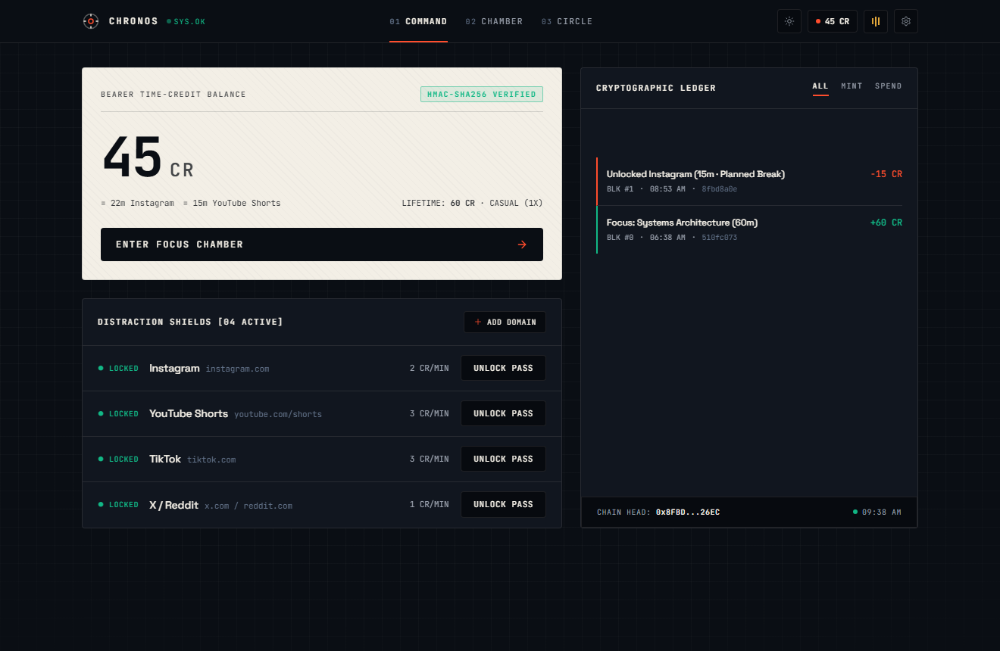
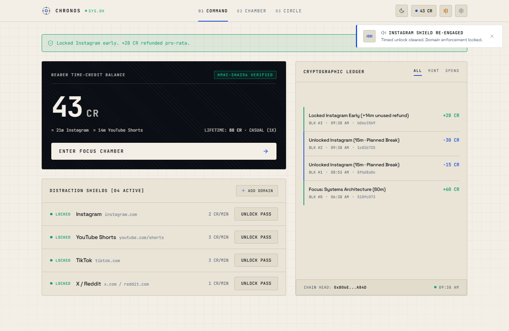
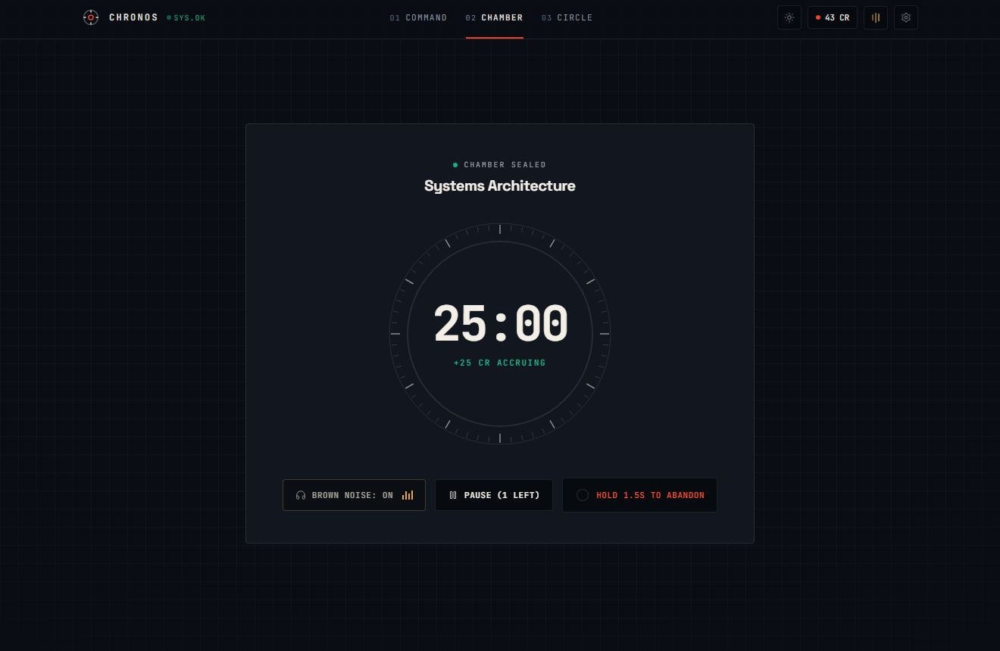
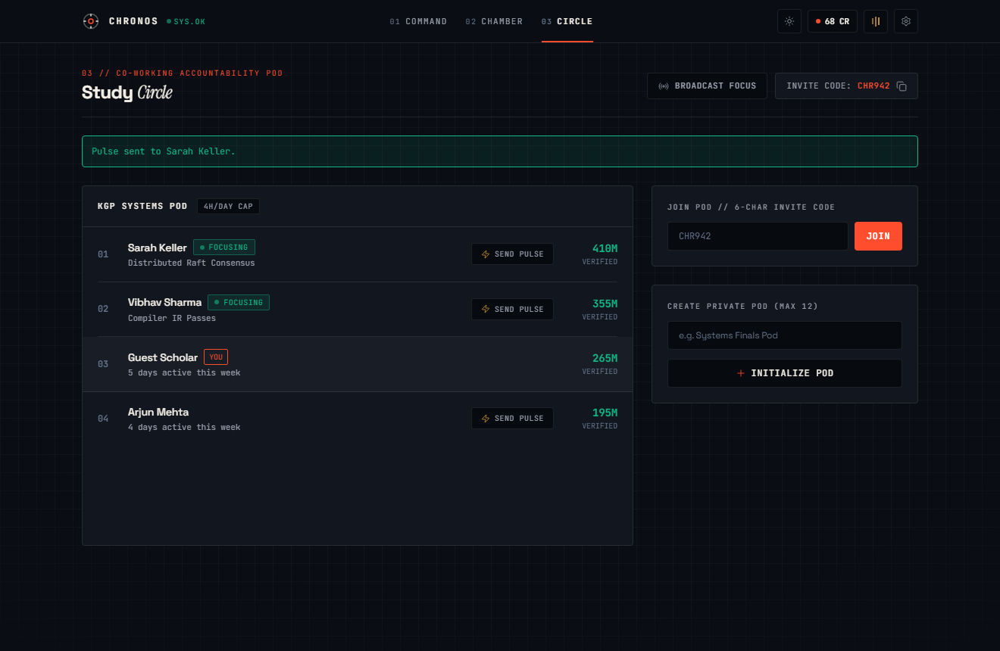

# Chronos — Horological Focus & Screen Time Economy

> Built for **#BuildHybridAI 2026** (Google / Firebase / Devpost).
>
> - **Live App:** https://chronos-ledger.kmzpatil.workers.dev
> - **Demo Video:** https://youtu.be/fVwFY6N0JPk
>
> **Attention is minted, not spent.** Chronos is a personal Focus & Screen Time Economy where deep work mints spendable recreation credits (`CR`), distracted domains (`instagram.com`, `youtube.com/shorts`, `tiktok.com`, `x.com`, `reddit.com`) are enforced by a companion **Manifest V3 Chrome Extension**, and unlocking requires a deliberate **2.0-second press-and-hold vault sequence**. Unused pass time can be locked early for an instant **pro-rata credit refund**.

---

## Screenshots

|             Command Center (Midnight Petrol)             |         Command Center (Paper & Cobalt Daylight)         |
| :------------------------------------------------------: | :------------------------------------------------------: |
|  |  |

|        Focus Chamber (60-Tick Horological Dial)        |            Study Circle (Co-Working Pod)             |
| :----------------------------------------------------: | :--------------------------------------------------: |
|  |  |

---

## Core Architecture

### 1. Three Focused Routes + Slide-Over Preferences
- **`/` — Command Center:**
  - **Alabaster Bearer-Bond Vault Card:** Displays real-time `CR` balance with GSAP odometer transitions, `HMAC-SHA256` verification badge, and live purchasing power equivalents.
  - **Distraction Shields:** Flush hairline-separated domain rows (`Instagram`, `YouTube Shorts`, `TikTok`, `X / Reddit`, plus custom `+ Add Domain` support). Standard educational YouTube lectures remain unrestricted.
  - **Intentional 2.0s Press-and-Hold Unlock Drawer:** Requires declaring an intention (`Reply to DM`, `Planned Break`, `Utility`, `Boredom`) and holding `2.0s` to scrub an animated diagonal-stripe vault meter.
  - **Cryptographic Ledger:** `idb`-backed IndexedDB + Web Crypto `crypto.subtle` HMAC-SHA256 hash-chained blocks with `ALL / MINT / SPEND` `GSAP Flip` filtering.
- **`/focus` — Horological Focus Chamber:**
  - Protected by Next.js middleware (`__session` HTTP-only cookie).
  - Strict 4-stage Finite State Machine (`IDLE` → `SEALED` → `DEBRIEF` → `MINTED`).
  - **60-Tick Precision Watch Dial SVG** with continuous sweeping sub-second hand, Screen WakeLock acquisition, **Web Audio Ambient Brown Noise** generator, 1-time Emergency Pause (`3m` auto-resume), and 1.5s Hold-to-Abandon (`Strict Stake` `-10 CR` penalty).
- **`/circle` — Study Circle (Co-Working Pod):**
  - Protected by Next.js middleware.
  - Create or join private pods via 6-character invite codes (max 12 members), broadcast live `FOCUSING` status with radar pulse rings, and send encouragement pulses.
- **Slide-Over `SettingsDrawer`:**
  - Economy Presets (`CASUAL 1.0x`, `STANDARD 0.75x`, `MONK 0.5x`) with a **24-hour anti-cheat loosening cooldown** (tightening applies immediately).
  - Pure **Web Audio API** polyphonic ringtone synthesizer (`Braun Chime`, `Marimba Pulse`, `Minimal Bell`) with zero MP3 dependencies.
  - One-click Anonymous Guest $\rightarrow$ Google / Email account upgrade (`linkWithPopup` / `linkWithCredential`) and JSON ledger export.

---

## Hybrid AI Architecture (Chrome Gemini Nano + Firebase AI Logic)

Chronos uses a 3-tier hybrid inference router in [`src/lib/ai/hybrid-router.ts`](./src/lib/ai/hybrid-router.ts) for post-session accomplishment debriefs:

1. **Primary On-Device Lane (Chrome Gemini Nano):** Uses `window.ai.languageModel` when available in Chrome to verify the user's 2-sentence deep-work summary completely locally with zero network latency or external data transmission.
2. **Cloud Fallback Lane (Firebase AI Logic):** When `window.ai.languageModel` is unavailable and **Strict Local AI** is disabled in Settings, Chronos dynamically imports `firebase/ai` (`getAI`, `GoogleAIBackend`, `getGenerativeModel`) at runtime—authenticated directly via the Firebase project (`armageddon-1351e`) with no raw Gemini API key exposed—to run cloud verification on `gemini-2.5-flash-lite`.
3. **Offline / Strict-Local Standby:** When offline or when **Strict Local AI** is toggled on, Chronos degrades gracefully to a local deterministic verifier before signing the `HMAC-SHA256` ledger block.

---

## Companion Manifest V3 Chrome Extension (`extension/`)

1. Open `chrome://extensions` in Google Chrome and enable **Developer mode**.
2. Click **Load unpacked** and select the [`extension/`](./extension) directory.
3. The extension uses `declarativeNetRequest` dynamic rules + `chrome.alarms` to block distracted domains, enforce `youtube.com/shorts` SPA navigation without blocking `/watch` lectures, and fire 2-minute warning notifications.

---

## Local Development

```bash
npm install
npm run dev
```

Open [http://localhost:3000](http://localhost:3000).

### Environment Configuration
Copy `.env.example` to `.env.local` and populate your Firebase project credentials when connecting live cloud sync:

```bash
cp .env.example .env.local
```

---

## License

Licensed under the [Apache License 2.0](./LICENSE).
